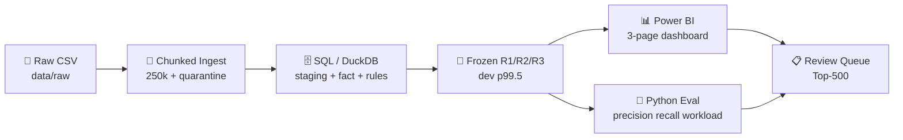
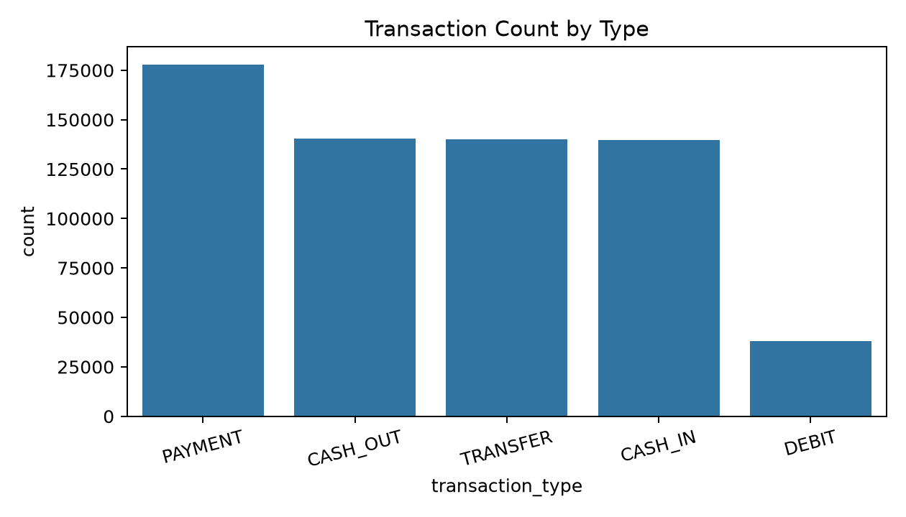
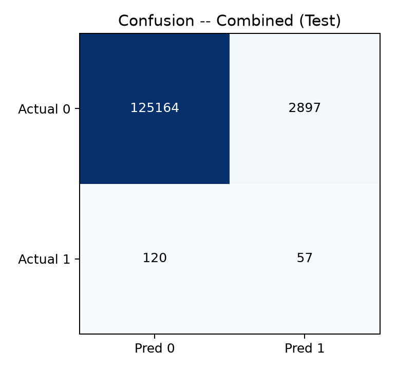
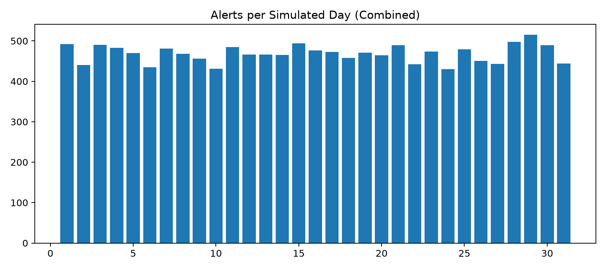

# Payment Fraud & Operational Anomaly Analysis — Fintech / Mobile-Money

<p align="center">
  
  <br/><br/>
</p>
<h1 align="center">🛡️ Payment Fraud & Operational Anomaly Analysis</h1>
<p align="center"><b>Catch More Fraud. Waste Fewer Reviews.</b></p>
  <p align="center">
    <i>A complete end-to-end analytics project — from SQL ingestion to Python
    screening rules to Power BI review queue — on 636K mobile-money transactions.</i>
  </p>
</p>

<p align="center">
  <a href="#"></a>
  <a href="#"></a>
  <a href="#"></a>
  <a href="#"></a>
  <a href="#"></a>
  <a href="#"></a>
</p>

<p align="center">
  
  
  
  
  
</p>

> ⚠️ **Disclaimer:** PaySim is synthetic. `step` is a simulation hour (not a
> calendar date), `amount` is unspecified local units (never relabeled),
> fraud-labeled value ≠ realized loss, and anomalies ≠ fraud. The 4 balance
> columns are excluded from all screening per the publisher warning
> (canceled fraud leaves balances frozen — using them would be leakage).

## Run it in one command

```bash
pip install -r requirements.txt
python gen_paysim.py --rows 636262          # or drop the Kaggle CSV into data/raw/
python run.py                                # ingest → rules → eval → exports → charts → findings
pytest                                       # 8 guardrail tests
```

Outputs: `data/processed/rule_performance.csv`, `review_queue.csv`,
`FactMonitoring.csv/.parquet`, `reports/findings.md`, 10 charts in
`reports/screenshots/`.

### 📚 Table of Contents
- [TL;DR — Executive Summary](#-tldr--executive-summary)
- [Key KPIs](#-key-kpis-at-a-glance)
- [Business Questions → Answers](#-business-questions--answers)
- [Architecture & Workflow](#️-architecture--workflow)
- [Repository Structure](#-repository-structure)
- [Dashboard Preview](#-power-bi-dashboard-preview)
- [Deep Dive Insights](#-deep-dive-insights)
- [Review Prioritization](#-review-prioritization)
- [Tech Stack](#️-tech-stack)
- [How to Run Locally](#-how-to-run-locally)
- [Business Recommendations](#-business-recommendations)
- [Future Roadmap](#-future-roadmap)
- [Author](#-author)

---

### 💡 TL;DR — Executive Summary

| Metric | Value |
| :--- | :--- |
| **Total Transactions** | `636,262` |
| **Fraud / Legit** | `820` / `635,442` |
| **Fraud Rate** | **`0.13%`** |
| **Total Value (local units)** | `25,436,825,287` |
| **Fraud-Labeled Value** | **`210,714,642`** (not realized loss) |
| **Existing Flag Recall (test)** | `0.00%` — 0 alerts on 177 fraud |
| **Combined Rules Recall (test)** | **`32.20%` at 1.93% precision** |

**One-line story:** *The legacy flag catches nothing — 3 transparent rules
frozen on dev catch 1 in 3 test frauds (57 of 177) for 2,954 reviews,
covering 52% of fraud-labeled value. R2 (TRANSFER > 200k) does the heavy
lifting; tighten R1 or require 2-rule agreement to cut the 52-reviews-per-hit cost.*

### 📊 Key KPIs at a Glance

| KPI | Value | Note |
| :--- | :--- | :--- |
| 🔴 **Fraud Rate** | **0.13%** | `820` of `636,262` |
| 💰 **Fraud-Labeled Value** | **210.7M local units** | 0.83% of total value |
| 🎯 **Combined Recall (test)** | **32.20%** | `57` of `177` fraud |
| 🔍 **Reviews per Hit (test)** | **51.8** | `2,954` alerts |
| 🚩 **Existing Flag Recall (test)** | **0.00%** | `0` alerts — dead control |

---

### 🔍 Business Questions → Answers

| # | Question | Answer |
| :--- | :--- | :--- |
| **1** | Fraud rate? | **0.13%** (820 / 636,262) |
| **2** | Fraud vs legit? | **820 vs 635,442** |
| **3** | Fraud-labeled value? | **210.7M local units** (≠ realized loss) |
| **4** | Which types carry fraud? | **Only TRANSFER (0.32%) and CASH_OUT (0.27%)** — synthetic |
| **5** | Does the existing flag work? | **No — 0.37% overall, 0% in test** (3 alerts total) |
| **6** | Strongest single rule? | **R2 TRANSFER>200k: 28.2% recall, 2.19% precision** |
| **7** | What do R1 / R3 add? | **R1: 2.8% / R3: 7.3% recall** — outliers + recipient bursts |
| **8** | Who to review first? | **Score 70+ → 40+ → amount → id** (Top-500 queue shipped) |
| **9** | Workload under capacity? | **100/250/500 per day evaluated** — sample fits, method shown |
| **10** | What to do? | See Recommendations below |

---

### ⚙️ Architecture & Workflow



**Flow:** CSV → chunked ingestion → SQL staging + fact → frozen rules →
Power BI dashboard + Python eval → prioritized review queue.

---

### 📁 Repository Structure

```
payment-fraud-operations-analysis/
├── 📂 data/raw/          # PaySim CSV, gitignored (636K x 11 sample here)
├── 📂 data/processed/    # rule_performance, review_queue, FactMonitoring (gitignored)
├── 📂 data/samples/      # demo_500.csv
├── 📂 sql/               # 01_schema → 08_powerbi_views (8 scripts)
├── 📂 src/               # ingest/validate/thresholds/rules/eval + db/config/metrics/rules helpers
├── 📂 notebooks/         # 01 exploration, 02 Isolation Forest comparison
├── 📂 powerbi/           # measures.dax + 3-page build guide
├── 📂 reports/screenshots/  # 10 charts (01–10)
├── 📂 docs/              # data + metric dictionary, interview walkthrough
├── 📂 config/rules.json  # frozen thresholds v0.1-dev
├── 📂 tests/             # 8 guardrail tests
├── run.py                # one-command local reproduction
└── gen_paysim.py         # synthetic generator
```

---

### 🖥️ Power BI Dashboard Preview

> 3-page dashboard fed by `vw_FactMonitoring` (or `FactMonitoring.csv`).

| Page 1: Transaction & Fraud Overview | Page 2: Control Effectiveness | Page 3: Review Queue |
| :---: | :---: | :---: |
|  |  |  |
| *Count / value / fraud-rate by type* | *Precision-recall, confusion, capacity* | *Top-500 queue, alerts per day* |

*All 10 charts pre-generated in `reports/screenshots/`. Build the live
`.pbix` via `powerbi/dashboard_build_guide.md` + `measures.dax`.*

---

### 🧠 Deep Dive Insights

#### 🔥 Best & Worst Slices
| Segment | Test Recall / Rate | Insight |
| :--- | :--- | :--- |
| **💀 Worst control: existing flag** | **0% recall in test** | 3 lifetime alerts — effectively dead |
| **✅ Best rule: R2 TRANSFER>200k** | **28.2% recall, 2.19% precision** | Large transfers are where fraud lives |
| **💸 R1 large-for-type** | **2.8% recall, 128 reviews/hit** | Costly per hit — tighten or pair it |
| **📡 R3 dest activity** | **7.3% recall** | Recipient bursts add what amount misses |

#### 📉 Fraud Concentrates Where Value Moves
Fraud appears **only in TRANSFER and CASH_OUT** — the cash-out legs.
PAYMENT / CASH_IN / DEBIT show 0% (synthetic property, stated honestly).

#### 💳 Amount Is Signal, Not Proof
Combined precision **1.93%** = 52 reviews per fraud found. Amount rules
surface candidates; analysts decide. Scores are triage priorities,
never fraud probabilities.

#### 🛡️ Leakage Guard Is the Whole Game
Balances freeze on canceled fraud (publisher warning). Any model reading
`oldbalance*`/`newbalance*` would look brilliant and be worthless.
Enforced by test + `config/rules.json` forbidden list.

---

### 🎯 Review Prioritization

From `run.py` → `data/processed/review_queue.csv` (Top 500):

| Priority Band | Score | Action |
| :--- | :--- | :--- |
| **🔴 High** | `70–100` (multi-rule hit) | Review first — signals agree |
| **🟠 Medium** | `40–69` (R1 alone) | Review unusually large-for-type |
| **🟡 Low** | `1–39` (R2 or R3 alone) | Verify context before escalation |

> Order is deterministic: `priority_score DESC, amount DESC,
> transaction_id ASC`. Capacity 100/250/500 per simulated day evaluated.

---

### 🛠️ Tech Stack

| Layer | Tools |
| :--- | :--- |
| **Data & DWH** | SQL Server (T-SQL, 8 scripts), DuckDB (local repro) |
| **Analysis** | Python, Pandas, NumPy, Matplotlib, Seaborn, Scikit-learn, Jupyter |
| **BI & Viz** | Power BI (DAX, 3-page dashboard) |
| **Ops** | Git, GitHub, pytest (8 tests) |

---

### 🚀 How to Run Locally

**1. Clone & data**
```bash
git clone https://github.com/<your-username>/payment-fraud-operations-analysis.git
cd payment-fraud-operations-analysis
python gen_paysim.py --rows 636262
# OR download the full 6.36M Kaggle CSV to data/raw/PS_20174392719_1491204439457_log.csv
```

**2. One-command run (DuckDB — no setup)**
```bash
pip install -r requirements.txt
python run.py     # → rule_performance.csv, review_queue.csv, FactMonitoring.*, 10 charts, findings.md
pytest            # 8 passed
```

**3. Production path (SQL Server / SSMS)**
```bash
sqlcmd -i sql/01_schema.sql
python src/ingest.py --csv data/raw/PS_20174392719_1491204439457_log.csv --truncate
python src/validate.py && sqlcmd -i sql/03_clean_transform.sql
python src/develop_thresholds.py && python src/apply_rules.py && python src/evaluate_rules.py
```

**4. Power BI**
```
Desktop → Get Data → FactMonitoring.csv (or SQL vw_FactMonitoring)
→ paste powerbi/measures.dax → follow powerbi/dashboard_build_guide.md
```

---

### 💡 Business Recommendations

| # | Play | KPI to Move | Measure |
| :--- | :--- | :--- | :--- |
| **1** | **Pilot combined R2+R1+R3 as triage** (not auto-block) | 0% → 32% recall | Test recall vs baseline |
| **2** | **Tighten R1 or require 2-rule agreement** | 52 → <30 reviews/hit | Precision & alerts/day |
| **3** | **Segment R3 recipients** (busy legit vs mule) | FPR on R3 | FPR by segment |
| **4** | **Monitor drift dev → test** (thresholds frozen) | Stable P/R | Precision/recall by day |
| **5** | **Keep `is_fraud` off the ops queue page** | Zero label leak | BI audit |
| **6** | **Strike team on High band first** (score 70+) | Fastest hits | Value recall |

---

### 🔮 Future Roadmap
- [ ] Full 6.36M run (`--rows 6362620`) + scale timing
- [ ] 2-rule-agreement variant to cut FPs
- [ ] Recipient segmentation for R3
- [ ] Drift monitor: precision/recall by simulated day
- [ ] Power BI incremental refresh + alerts

---

### 👤 Author

**TODO: put your name here** — Data Analyst | SQL • Python • Power BI

> Replace with your links:
> [](https://linkedin.com/in/<your-handle>)
> [](https://your-portfolio.com)
> [](mailto:you@example.com)

---

<p align="center">
  <b>⭐ If this helped you, please give it a star — it helps others discover it!</b><br/>
  <i>Built with ❤️ for fraud-ops teams who hate surprises.</i>
</p>

<p align="center">
  
</p>

---

## Appendix — module notes (for maintainers)
